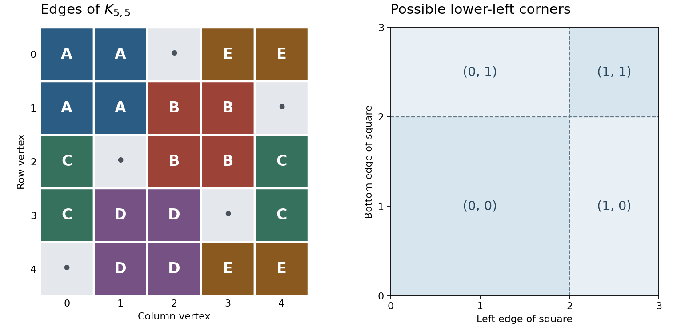

# When does a balanced biclique partition give a square tiling?

For a positive integer board side $n$, every balanced biclique partition with positive tile sides smaller than the board admits a square tiling with the same side lengths **exactly when $n=1,2,3,4,6$**. A balanced biclique of side $s$ occupies the Cartesian product of any $s$ rows and $s$ columns. The geometric tiles are axis-parallel squares with arbitrary real coordinates and disjoint interiors. The formal statement and proof require coverage of the boundary as well. [Aaron Meyerowitz’s question](https://mathoverflow.net/questions/341688)

## A counterexample on five vertices per side

Label rows and columns modulo 5. For each label $i$, take the two rows $i,i+1$ and the two columns $2i,2i+1$. These five products share no edges. Two different products that share a row have indices differing by one, so their column pairs are disjoint. In row $i$, the uncovered entry is column $2i+2$. The five products and those five singletons partition all 25 edges.

The five four-cycles are the cyclic packing in Lemma 2.1 of Billington, Fu and Rodger’s 2001 paper. Relabeling each column $j$ as $3j-1$ modulo 5 sends the uncovered matching to the diagonal and identifies the constructions. Lemma 2.2 of the same paper gives the maximum four-cycle packing number on general bipartite boards. [Billington, Fu and Rodger, pp. 109–110](https://ir.lib.nycu.edu.tw/bitstream/11536/30000/1/000167263300003.pdf#page=3)

A geometric square of side two in the board has lower-left corner $(x,y)$ with both coordinates between 0 and 3. The pair $(\lfloor x/2\rfloor,\lfloor y/2\rfloor)$ has just four possible values. Two squares with the same pair overlap in their interiors. The five tiles of side two therefore prevent a tiling. The same argument bounds the number of tiles of side at least $s$ in a board of side $L$ by $\lfloor L/s\rfloor^2$.

## The other counterexamples

* On a board of side $2h+5$, enlarge the five-vertex construction by adjoining $h$ groups of two row vertices and $h$ groups of two column vertices. Each five-by-two strip contributes two more side-two bicliques and each two-by-two block contributes one. The resulting $(h+2)^2+1$ side-two tiles exceed the geometric capacity by one.
* Replacing each of the five original row and column vertices by $t$ copies gives five bicliques of side $2t$. Fill unused edges with singletons. This works whenever $5t\le n<6t$, which covers every $n\ge25$. A variant with three extra vertices gives five bicliques of side $2q+1$ whenever $5q+3\le n<6q+3$. These two constructions cover the even sizes from 8 through 24 except 12.
* At side 12, use four tiles of side 5, one of side 4 and 28 singletons. The large bicliques come from attaching blocks of $2,3,2,3,2$ vertices to the edges of a five-cycle on the row side and its complementary cycle on the column side. Every pair of large tiles has total side at least 9. If two geometric tiles are horizontally separated, the left tile starts at or before $12-9=3$ and the right tile starts at or after 4. The same holds vertically. Marking each starting coordinate according to whether it is below 4 gives four possible pairs of marks for five tiles. [Explicit row and column sets](twelve.json)

## The boards where the converse holds

At side 1 the proper-side and area conditions cannot both hold. At sides 2, 3 and 4 there are respectively one, two and six feasible multisets of tile sizes. One constraint removes the spurious profiles immediately. If two balanced bicliques have sizes whose sum exceeds $n$, both their row sets and their column sets intersect, so they share an edge. Each surviving profile has an explicit grid tiling.

At side 6 there are 42 multisets of proper positive side lengths with the right area. Thirty have explicit grid tilings. Nine contain a pair with total side greater than 6. In the last three, the counts of tiles of sizes 1, 2, 3 are respectively $(3,6,1),(2,4,2),(1,2,3)$. In any row or column meeting exactly one size-three biclique, parity forces a singleton.

* With one size-three biclique and three singletons, all the singletons must use its three rows and its three columns, where their edges are already occupied.
* With two or three size-three bicliques, choose two. Their row sets or their column sets are disjoint. On that axis they exhaust all six coordinates. A third biclique, if present, covers only three of them. This forces at least six or three singletons respectively, exceeding the available two or one.

The 30 grid layouts cover every integer cell. Taking the closure of each unit cell shows they also cover the entire real board, including its upper and right edges. In the census file each pair of masks lists the rows and columns of a non-unit tile, with bit zero denoting the first coordinate. Every uncovered cell takes a singleton. [Census and layouts](six-profiles.json)

## Lean verification

`SquaredTwelve.classification` in [SquareClassification.lean](SquareClassification.lean) gives the full equivalence. `MOSmall.least_counterexample` proves minimality and `OMA.disproof` refutes the universal statement. The file imports the public definitions formalized by @LDJAI. [Axiom audit](ClassificationAudit.txt)

The companion file formalizes the classical four-cycle packing number and an upper bound for every size threshold. If each selected biclique has side at least $k$, then each of its rows contains at most $\lfloor n/k\rfloor$ selected bicliques, giving a total bound of $\lfloor n\lfloor n/k\rfloor/k\rfloor$. For $k=2$ the proof constructs a packing attaining the bound for every $n$. [Four-cycle packing proof](FourCyclePacking.lean) · [Axiom audit](FourCycleAudit.txt)
